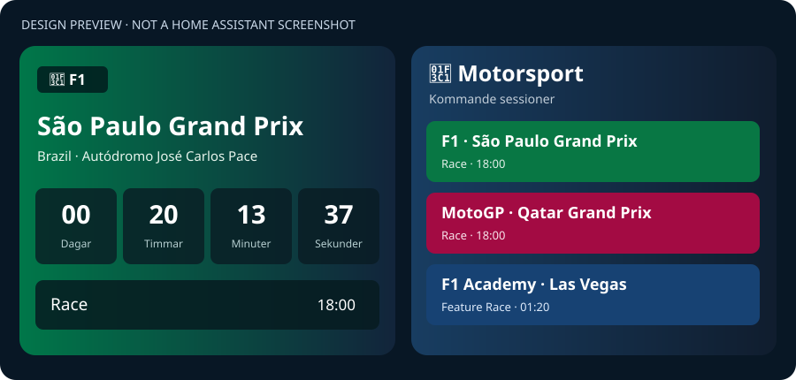

# HA Motorsport Card 🏁

A Lovelace dashboard card for [Lightsouts Motorsport Calendar](https://github.com/mm98/ha-lightsouts-motorsport-calendar). Displays upcoming sessions with a live countdown, expandable race-weekend schedule and a multi-series motorsport overview.


*Source-integration icon from Lightsouts; this is not a screenshot of the Motorsport Card.*



*Illustrative design mockup. The final appearance in Home Assistant may differ.*

> **Development preview** — currently on `dev`. No production or beta release has been published or validated inside Home Assistant yet.

## Features

- Countdown to the next selected series session: days, hours and minutes (dd hh mm)
- Series-specific accent colors and circuit/country labels
- Expandable schedule that includes retained completed sessions (struck through), as well as the next session highlighted
- Multi-series overview with selectable vertical list or responsive two-column grid, sorted by upcoming or currently scheduled sessions; simultaneous starts are supported
- Tap a series in the overview to expand that specific event's race-weekend schedule; tap again to collapse it
- Compact mode and responsive layout
- Tap to expand the session list; configurable long press (650 ms) for dashboard navigation or more-info
- Visual card editor for calendar, series, view, horizon and hold behavior
- Shared in-browser calendar request cache
- Handles date-only multi-day events like WRC rallies
- Requests seven days of retained calendar history, if available in Lightsouts; old events cannot be reconstructed if the source removed them

> Session status is inferred from scheduled start/end times. This card does **not** show verified live results, timing or race-control status.

## Data source

Requires the third-party Lightsouts integration and its calendar. The calendar entity might be `calendar.lightsouts` or, depending on your installation, e.g. `calendar.externa_sensorer_lightsouts`. Set the actual entity ID in the card editor.

## YAML examples

### Formula 1 card with long press navigation

```yaml
type: custom:motorsport-card
calendar_entity: calendar.externa_sensorer_lightsouts
series: F1
view: series
hold_action:
  action: navigate
  navigation_path: /lovelace/f1-sensor
```

Use **your own** dashboard view path. A normal tap expands the session list, while a long press navigates.

### Overview of all available series

```yaml
type: custom:motorsport-card
calendar_entity: calendar.externa_sensorer_lightsouts
series: all
view: overview
overview_layout: grid # grid or list
max_series: 12
days_ahead: 120
```

See [more configuration examples](examples/).

## Installation status

This project is being developed for the Home Assistant Marketplace / HACS as a **Dashboard (plugin)** repository.

`hacs.json` points to the self-contained bundle `dist/motorsport-card.js`. The Marketplace can register the JS module automatically when a valid release is available; do not treat the `dev` branch as a supported release.

For temporary **manual testing only**, copy `dist/motorsport-card.js` to `config/www/motorsport-card.js`, then add the following dashboard resource of type **JavaScript module**:

```
/local/motorsport-card.js
```

Reload the browser and add one of the YAML examples above. This route is for development; release installs will use the Marketplace-managed resource.

## Release process

`dev` → `beta` → `main` (stable). HA tests must be done from `beta`; `dev` is for code development only. No stable tag until beta behavior has been verified. See [development notes](docs/DEVELOPMENT.md).

## Testing

```sh
node --check dist/motorsport-card.js
node --test tests/card.test.cjs
```

GitHub Actions includes both JavaScript testing and Marketplace/HACS repository validation.

## Roadmap

- Real-world Home Assistant tests (calendar response shape, long press on touch)
- Improve schedule grouping, status handling, accessibility and localization
- Full set of series styles and screenshot documentation
- Beta release, then stable release after feedback

## Credits

The data source is [Lightsouts Motorsport Calendar](https://github.com/mm98/ha-lightsouts-motorsport-calendar), which retrieves schedules from [lightsouts.com](https://lightsouts.com/). This is an independent frontend card.

## License

MIT. See [LICENSE](LICENSE).
